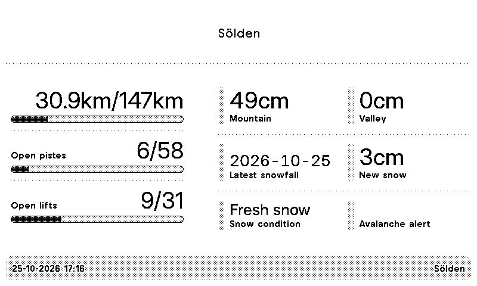

#  TRMNL Ski Resort Snow Report

Show your favourite ski resort's status on your [TRMNL](https://usetrmnl.com/)

## Installation

Data comes from [liftradar.eu](https://liftradar.eu).

- Add the [Ski Resort Snow Report](https://trmnl.com/recipes/ski-resort-snow-report-219253) plugin on your TRMNL website.
- Open [liftradar.eu](https://liftradar.eu) and search for your resort.
- Right-click its **JSON** link and choose **Copy link address**. It looks like `https://liftradar.eu/json/at/soelden.json`.
- Paste that link into the **Resort** field in the plugin settings.

## Development

Layouts in `TRMNL/src` are synced directly with TRMNL, so changes made on the TRMNL website show up here as commits.

## FAQ

### Data field is missing for my resort

Please check if [liftradar.eu](https://liftradar.eu) provides this data for the given resort. Various resorts have different data available.
